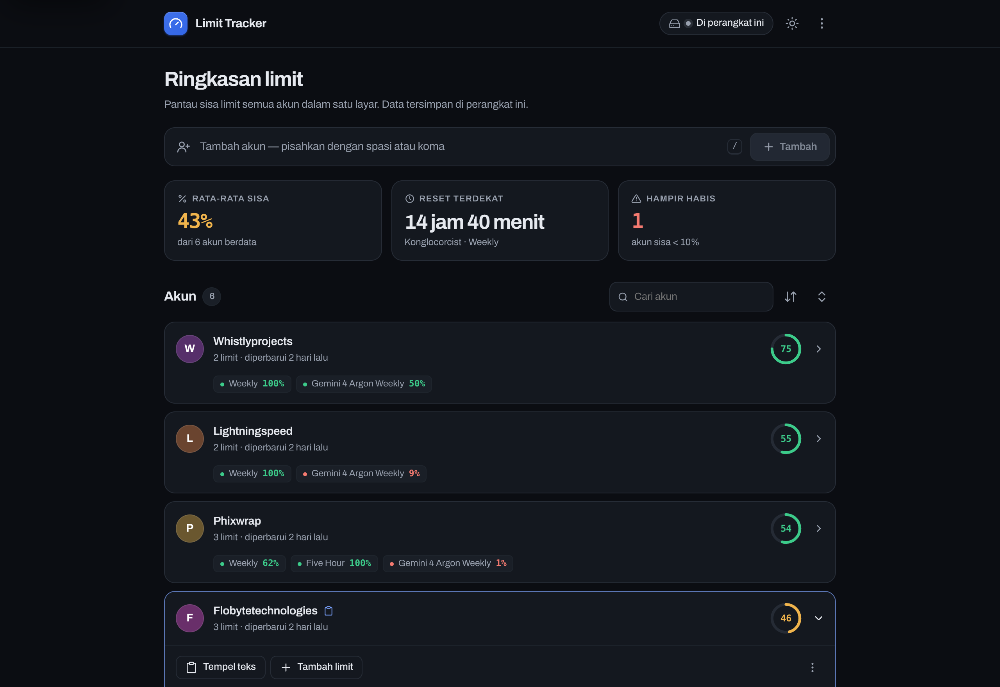

# Limit Tracker

Satu halaman untuk memantau sisa limit beberapa akun. Tanpa server, tanpa build step —
data disimpan di perangkat, dengan opsi menautkan ke file JSON supaya bisa dibawa
antar-browser atau disinkronkan lewat folder cloud.



## Menjalankan

Buka `limit_tracker.html` langsung di browser, atau jalankan server statis:

```bash
python3 -m http.server 8000
# lalu buka http://localhost:8000/limit_tracker.html
```

> **Catatan browser.** Tombol *tautkan file JSON* memakai File System Access API, yang
> saat ini hanya ada di browser berbasis Chromium (Chrome, Edge, Opera). Firefox dan
> Safari tetap bisa dipakai; penyimpanan otomatis jatuh ke `localStorage` dan cadangan
> diambil lewat **Unduh .json**.

## Cara pakai

1. **Tambah akun** — ketik satu atau beberapa nama di kolom paling atas, pisahkan dengan
   spasi atau koma.
2. **Tempel teks limit** — salin teks limit dari aplikasi asal, lalu tekan
   <kbd>Ctrl</kbd>+<kbd>V</kbd> saat halaman aktif (tempel ke akun yang sedang terpilih),
   atau buka kartu akun → **Tempel teks**. Teks diparsing otomatis: grup, nama limit,
   persentase, dan waktu reset.
3. **Pantau** — kartu tertutup menampilkan ringkasan semua limit sekaligus; buka kartu
   untuk detail, edit manual, atau hapus.

## Fitur

- Parsing teks limit otomatis (Indonesia & Inggris: `2 hari 4 jam`, `in 6 hours`, `90`).
- Tiga kartu ringkasan: rata-rata sisa, reset terdekat, jumlah akun hampir habis.
- Urutkan berdasarkan sisa rata-rata, nama, waktu pembaruan, atau limit tertentu saja.
- Pencarian instan, tema terang/gelap, animasi yang menghormati `prefers-reduced-motion`.
- Tautkan file JSON → penyimpanan otomatis tiap perubahan.
- Undo untuk hapus akun dan hapus limit.

## Pintasan keyboard

| Tombol | Aksi |
| --- | --- |
| <kbd>/</kbd> | Fokus ke kolom tambah akun |
| <kbd>↑</kbd> <kbd>↓</kbd> | Pindah akun terpilih |
| <kbd>Ctrl</kbd>+<kbd>V</kbd> | Tempel teks limit ke akun terpilih |
| <kbd>Esc</kbd> | Tutup menu / bersihkan pencarian |

## Format data

`limit-tracker.json`

```json
{
  "accounts": [
    {
      "id": "mw238r4bym5",
      "email": "Contoh Akun",
      "open": false,
      "limits": [
        {
          "section": "Claude and GPT models",
          "label": "Weekly Limit Remaining",
          "pct": 51,
          "resetAt": 1794293160000
        }
      ],
      "updatedAt": 1793797265383
    }
  ],
  "sort": "avg",
  "sel": "mw238r4bym5",
  "all": false
}
```

`pct` adalah **sisa** limit dalam persen (0–100). `resetAt` berupa epoch milidetik atau
`null` bila tidak ada jadwal reset; begitu waktunya lewat, limit dianggap penuh kembali.

## Struktur file

| File | Isi |
| --- | --- |
| `limit_tracker.html` | Markup, ikon inline, boot tema anti-kedip |
| `style.css` | Token warna/tipografi + komponen |
| `app.js` | State, render, parser teks, integrasi file |
| `limit-tracker.json` | Contoh data |

## Palet

Warna dipakai secara semantik, bukan dekoratif:

- **Netral** (abu-abu dingin) untuk semua permukaan dan teks.
- **Biru** hanya untuk interaksi: tombol utama, fokus, akun terpilih.
- **Hijau / kuning / merah** hanya untuk data status (sisa ≥50%, 10–49%, <10%).

Semua teks memenuhi kontras WCAG AA (≥ 4.5:1) di `--bg`, `--surface`, dan `--surface2`
pada kedua tema.
